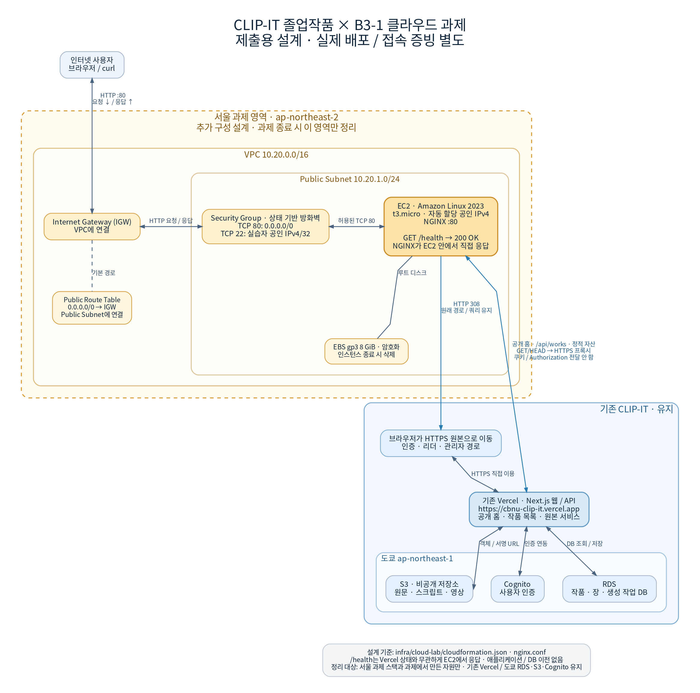

# CLIP-IT · 졸업작품 기반 AWS 클라우드 배포 과제

CLIP-IT은 고전 문학 원문과 AI 영상 장면을 함께 감상하는 졸업작품 웹 서비스입니다. 이번 과제에서는 기존 서비스에 **서울 리전의 독립 VPC와 EC2/Nginx 공개 접속 지점**을 추가합니다.

- 졸업작품 저장소: [SW-Clip-It/Capstone_FE](https://github.com/SW-Clip-It/Capstone_FE)
- 기존 운영 서비스: [CLIP-IT](https://cbnu-clip-it.vercel.app)
- 기존 프로젝트의 EC2 구성 참고: [고정된 준비 기록](https://github.com/SW-Clip-It/Capstone_FE/tree/0c7cb1404fa97db3f8f1196524e82e4195212955)
- 원래 과제 양식 1~8번 적용: [CLIP-IT 과제 명세](docs/assignment-spec.md)

**현재 이 제출본에는 배포 구성과 로컬 검증 기록이 있습니다. 실제 AWS 배포·외부 접속·삭제 증빙은 별도로 진행하는 배포 작업의 결과를 반영해야 합니다.**

## CLIP-IT 적용 범위

| 구분 | 담당 역할 | 이번 과제에서의 처리 |
| --- | --- | --- |
| 서울 VPC·Public Subnet·IGW·Route Table | EC2의 독립 네트워크와 인터넷 경로 | 과제용으로 생성·검증·삭제 |
| 서울 EC2 / Nginx | 공개 화면 프록시, 고정 `/health` 응답 | 과제용으로 생성·검증·삭제 |
| 기존 Vercel / Next.js | CLIP-IT 웹 화면과 API | 기존 운영 서비스 유지 |
| 기존 도쿄 RDS·Cognito·S3 | 문학·장면 데이터, 사용자 인증, 비공개 영상 저장 | 기존 운영 리소스 유지 |
| 기존 스크립트·영상 파이프라인 | 원문·스크립트 등록과 영상 생성 작업 연동 | 졸업작품 배경 기능; 이번 실습의 추가 개발 범위 아님 |

EC2의 공개 홈·작품 목록·정적 파일은 기존 CLIP-IT 화면을 HTTPS로 전달받습니다. `/health`는 **EC2 Nginx가 직접** `200`과 `OK`를 반환합니다. 로그인·회원가입·리더·관리자 등 나머지 경로는 기존 HTTPS 운영 주소로 이동합니다. 프록시는 Cookie·Authorization을 전달하지 않고 응답 Set-Cookie를 제거합니다.

완료 기준은 EC2 접속 지점의 네트워크·웹 서버 동작입니다. 앱 전체·DB의 EC2 이전과 AI 영상 생성 품질 검증은 포함하지 않습니다.



## 필수 제출물

| 과제 요구 | 제출 파일 / 기록 | 이 제출본의 상태 |
| --- | --- | --- |
| 아키텍처 1장 | [docs/architecture.png](docs/architecture.png) | CLIP-IT 운영 영역과 서울 실습 영역을 구분한 설계 |
| 외부 접속 증빙 | 아래 B 방식, 실제 IP/URL과 스크린샷 | 실제 EC2 증빙 반영 대기 |
| 트러블슈팅 보고서 | [docs/troubleshooting.md](docs/troubleshooting.md) | 실제 로컬 재현 기록과 EC2 추가 기록 항목 |
| 리소스 정리 체크리스트 | [docs/cleanup-checklist.md](docs/cleanup-checklist.md) | 실제 삭제 조회 결과 반영 대기 |

리소스 ID·접속 URL·검증 시각은 [배포·검증 기록](docs/deployment-record.md)에 모읍니다. 실행하지 않은 항목은 완료로 표시하지 않습니다.

## 외부 접속 검증 — B 방식

선택 방식은 **B: `GET http://<EC2_PUBLIC_IP>/health`**입니다. 외부 PC에서 실행합니다.

```bash
curl --fail --include --max-time 15 http://<EC2_PUBLIC_IP>/health
```

기대 결과는 HTTP `200`, `Content-Type: text/plain`, 본문 `OK`입니다. 실제 URL/IP와 응답이 함께 보이는 스크린샷을 `docs/evidence/external-health.png`에 저장하고 배포 기록에 연결합니다.

| 접속 정보 | 값 |
| --- | --- |
| 검증 당시 EC2 공인 IP / URL | 기록 대기 |
| KST 시각 / HTTP 상태 / 본문 | 기록 대기 |
| 외부 접속 스크린샷 | 실제 배포 후 첨부 |
| SSH / localhost `/` 200 / HTTPS 아웃바운드 | 실제 EC2 검증 후 첨부 |

기존 Vercel 주소와 로컬 Docker 응답은 EC2 외부 접속 증빙을 대신하지 않습니다. `/health`만으로 DB·로그인·영상 재생 상태를 판정하지 않습니다.

## 배포·검증·정리

사용하는 구성은 [infra/cloud-lab/](infra/cloud-lab/README.md)입니다. 서울 `ap-northeast-2`, Amazon Linux 2023, `t3.micro` 한 대, 암호화 gp3 8 GiB, HTTP 80 공개, SSH 22 개인 공인 IPv4 `/32`로 제한합니다.

1. 실습용 IAM 사용자/Role과 네트워크·컴퓨트 제한 정책 두 개를 준비합니다.
2. 계정의 무료 이용·잔여 크레딧과 EC2/EBS/공인 IPv4/전송 비용 적용을 확인합니다.
3. 배포 가이드의 환경변수를 설정하고 `lab.sh preflight` → `deploy` → `verify`를 실행합니다.
4. 실제 AWS 출력과 외부 접속 화면을 배포 기록에 반영합니다.
5. CLI `deploy`로 생성했다면 **생성 기록이 있는 같은 체크아웃**에서 정확한 StackId를 확인해 `lab.sh cleanup`을 실행합니다. 콘솔에서 생성했다면 정확한 실습 StackId와 리소스 목록을 확인해 콘솔에서 해당 스택을 삭제합니다. 두 경우 모두 ID별 잔여 조회 후 정리 체크리스트를 완료합니다.

이 문서 개정은 AWS 리소스를 생성하거나 기존 배포·복구 예약을 변경하지 않습니다. 기존 Vercel·도쿄 운영 리소스는 실습 정리 대상에서 제외합니다. 제출 문서와 검증 기록은 임시 인프라를 삭제한 뒤에도 보존합니다.

## 증빙과 이전 구현

- [증빙 목록](docs/evidence/README.md): 로컬·기존 운영·실제 EC2 기록 구분
- [배포 및 로컬 확인 방법](infra/cloud-lab/README.md): 템플릿·문법·Nginx 검증
- [이전 독립 실습 구현](legacy/README.md): `Hello Cloud` 예제와 이전 `manage.py` 보관. 현재 진입점은 `infra/cloud-lab/lab.sh`입니다.
